```{r include=FALSE}
knitr::opts_chunk$set(
  collapse = TRUE,
  comment = "#>"
)
```


```{r setup, echo=FALSE}
knitr::opts_chunk$set(
	message = FALSE,
	warning = FALSE,
	tidy = TRUE,
	fig.pos = "h"
)
options(width = 100)
knitr::opts_chunk$set(tidy.opts=list(width.cutoff = 75))

```


```{r include=FALSE}
# the code in this chunk enables us to truncate the print output for each
# chunk using the `out.lines` option
# save the built-in output hook
hook_output <- knitr::knit_hooks$get("output")

# set a new output hook to truncate text output
knitr::knit_hooks$set(output = function(x, options) {
  if (!is.null(n <- options$out.lines)) {
    x <- xfun::split_lines(x)
    if (length(x) > n) {
        
      # truncate the output
      x <- c(head(x, n), "....\n")
    }
    x <- paste(x, collapse = "\n")
  }
  hook_output(x, options)
})
```


```{r, message = FALSE, warning = FALSE}
library(DrugScreenExplorer)
library(tidyr)
library(dplyr)
library(gridExtra)
library(ggplot2)
library(tools)
```


# Installation

The *DrugScreenExplorer* package can be installed from  Bioconductor using the 
following commands:

```{r, eval = FALSE}

if (!requireNamespace("BiocManager", quietly = TRUE))
     install.packages("BiocManager")
BiocManager::install("DrugScreenExplorer")

```


# Introduction

*DrugScreenExplorer* offers an intuitive R Shiny application, empowering users 
of all technical backgrounds to conduct comprehensive drug screen analyses 
through an interactive web interface. The application seamlessly integrates all 
functionalities of the underlying R package within its user-friendly graphical 
interface.

With just a few clicks, this R Shiny app allows users to effortlessly:

* Import and merge raw drug screening datasets  
* Process and normalize the resulting data  
* Adjust the potential bias due to edge effects  
* Summarize dose-response effects  
* Analyze the synergy or antagonism effects of two-drug combination   
* Explore the relationship between drug response and features    

# Initiate the Shiny Application

There are two ways to start the Shiny Application: 

**1 Execute `*runShiny()*` function directly**

This approach requires organizing all input files - including well annotations, 
plate annotations, and raw screening data - into structured folders with specific 
naming conventions. The entire directory structure should then be compressed into 
a single ZIP archive for import into the Shiny application.

```
Shiny Data/
├── plateAnno
├── rawData
└── wellAnno

```

The files within these three folders must adhere to the format specifications 
required by the `readScreen()` function. For guidance on preparing these files, 
please consult the following functions in our documentation:The files within 
these three folders must adhere to the format specifications required by the 
`readScreen()` function. For guidance on preparing these files, please consult 
the following functions in our documentation:

- `readScreen()` - Read and assemble a drug screen dataset
- `createWellInput()` - Create a template for well annotation file
- `createPlateInput()` - Create a template for plate annotation file

Fortunately, the *DrugScreenExplorer* package incorporated a function 
(*createShinyData*) to generate the required data within one-step.  

```{r chunk_label, echo = TRUE, eval = FALSE}
createShinyData(rawDir,
                plateAnnotationFile,
                wellAnnotationFile,
                dir = ".")
```

**2 Run `*makeShiny()*` function** 

The second strategy to start the Shiny application is to run *makeShiny()* function. 
The function create a directory comprising R shiny script and required data. We can 
directly start the Shiny application by running the generated script using R. 

# First-look of the Shiny Application

The Shiny application contains the following tabs:

- `Data preprocessing` - Includes data import, normalization, and correction for 
edge effects.
- `Plate Plot` - Provides an overview of each plate.
- `Dose-response curves` - Visualizes dose-response curves for selected drugs 
and samples.
- `Clustering` - Shows similarities between drugs or samples.
- `Association test`- Examines relationships with sample information.
- `Overview Two-Drug Combination` -  Summarizes of two-drug combinations.
- `Durg Combination Effects` - Illustrates the effects resulting from two-drug 
combinations.


``` {r, out.width = "900px", echo = FALSE}
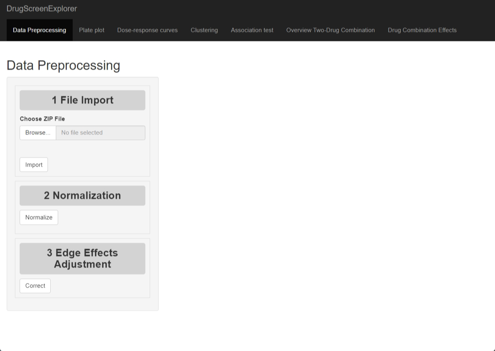

```

# Data preprocessing 

## Data import

As mentioned earlier, the Shiny application imports a ZIP file generated by 
compressing a structured folder containing well annotations, plate annotations, 
and raw screening data. This compressed file can be directly created using the 
*createShinyData()* function.

Once the path to the compressed data is specified, several additional parameters 
must be configured before importing: 

- The row and column ranges containing the actual values; 
- The separator between these values;  
- Whether commas is used as the decimal.  

These are indeed required arguments in *readScreen()* function. Please refer to 
the help document of *readScreen()* for information. 

After setting these options, clicking the "Import" button will load and combine 
all data into a single table. Upon successful import, the right panel will 
display an overview of all samples. Additional details can be viewed by selecting 
specific sample information.

``` {r, out.width = "900px", echo = FALSE}
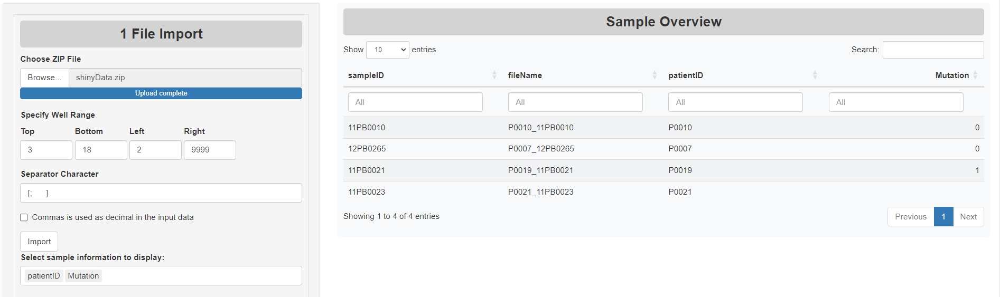

```

## Normalization

Adapted from *normalizePlate()* function, this R Shiny application offers two 
normalization methods: 'negatives' or 'NPI'. The 'negatives' method requires 
specifying negative controls, while 'NPI' needs both negative and positive drug 
information For details, please refer to the normalizePlate() function 
documentation. Note that normalization can be a time-consuming process; please 
be patient.  

This procedure will return and display a table containing the following default 
columns:

- SampleID   
- fileName   
- wellID  
- rowID  
- colID  
- drug name  
- original values  
- normalized values  

Additional columns can be included by selecting the desired options under 
"Select sample information to display". These columns might be 
indispensable when exploring the relationship between drug effects and sample 
annotations in the *Association test* panel. 


```{r, out.width = "900px", echo = FALSE}

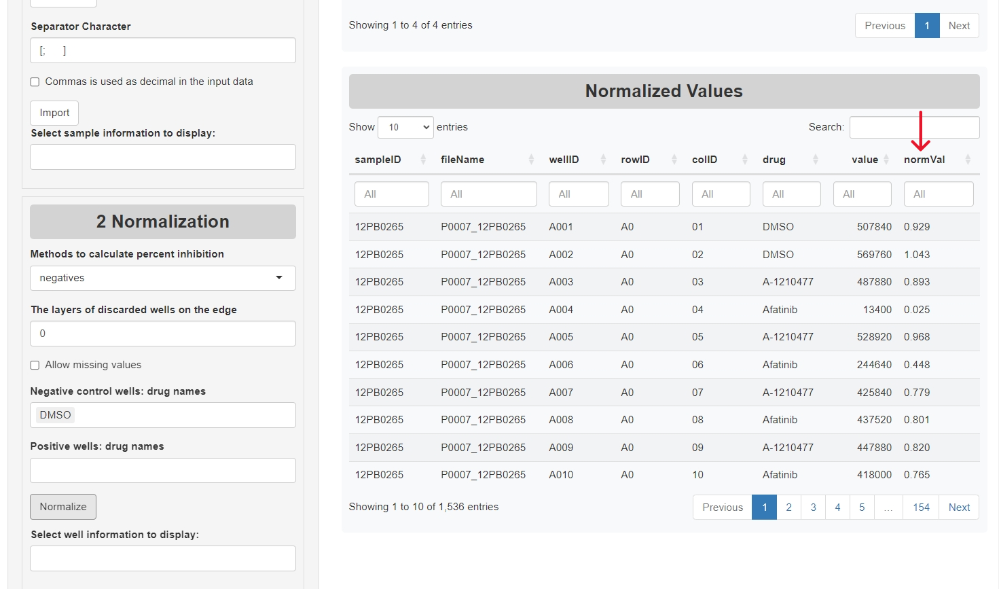

```

## Edge effects Adjustment

The final step in data processing is edge effect adjustment, performed by the 
*correctEdgeEffect()* function. Currently, two methods are supported for 
estimating edge effects:

- 'loess': Uses a local regression model to estimate edge effects.
- 'sigmoid': An experimental feature that applies a 2D-sigmoid model for 
estimation.


This adjustment process is also computationally intensive. Upon completion, a 
new column named *normVal.cor* will be added to the normalized data table.


```{r, out.width = "900px", echo = FALSE}

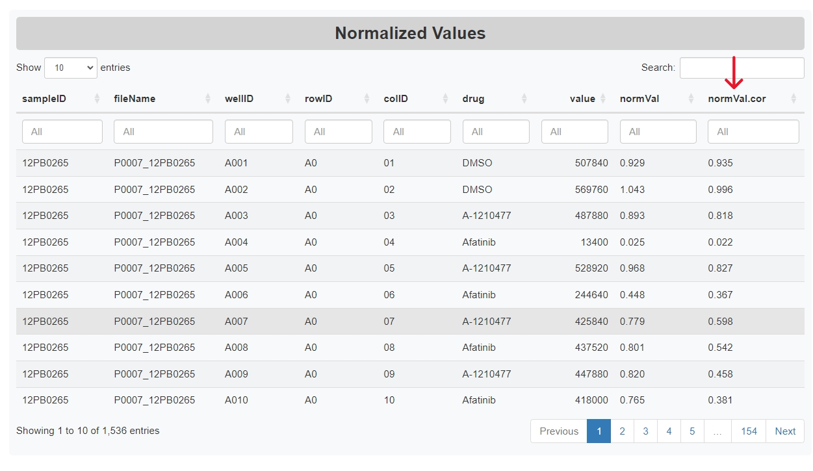

```


# Visualize the drug screen plate

The *Plate plot* panel displays a heatmap of a selected plate, showing values 
such as viability, adjusted viability, z-score, or raw count. Detailed 
information for each well can be accessed by clicking on it in the heatmap. This 
action generates a table containing comprehensive drug information and a line 
plot illustrating how the selected value changes across different concentrations 
of the corresponding drug. 

```{r, out.width = "900px", echo = FALSE}

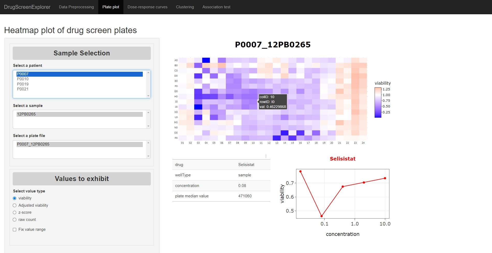

```


# Explore the dose-response effects of drugs


```{r, out.width = "900px", echo = FALSE}

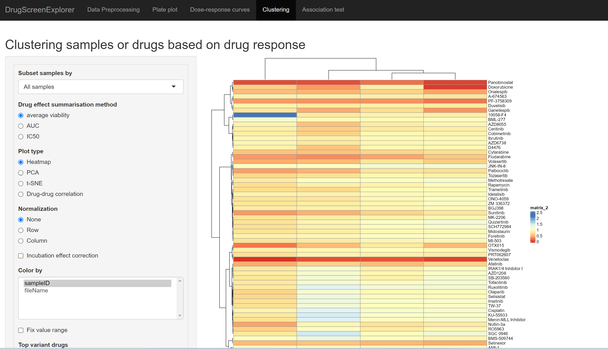

```

With the panel *Clustering samples or drugs based on drug response*,  users can 
easily explore the similarity between samples or drugs. The similarity can be 
calculated based on three drug effect summarization measures: average viability, 
AUC, and IC50. 

The Shiny application provides several methods to assess and visualize these 
similarities. Among them, hierarchical clustering and correlation analysis are 
intuitive approaches for measuring similarity, and the results are visualized 
using heatmaps. 

PCA was applied to the drug effect summarization values to extract principal 
components. The first two components, which capture the largest variance, were 
visualized using scatter plots to illustrate the distances between samples or 
drugs. Similarly, t-SNE was used to project the high-dimensional data into a 
two-dimensional space. The resulting embeddings were displayed in scatter plots, 
highlighting relative distances and clustering patterns. 

# Test associations between drug responses and sample annotations

The R shiny application enables a simple exploration on the association between
the obtained drug responses (i.e., average viability, AUC, and IC50) to a 
specific sample annotations. 

The sample annotation can be binary, categorical, or continuous. For binary 
annotations, a Student's t-test will be performed, supporting both equal and 
unequal variance assumptions. The results, including mean differences, p-values, 
and adjusted p-values are summarized in a table. By clicking on a row, a box 
plot will be generated to visualize the distribution between the two groups.

Anova test will be performed for a categorical annotation variable, and a 
similar boxplot will be drawn for each drug.  


```{r, out.width = "900px", echo = FALSE}

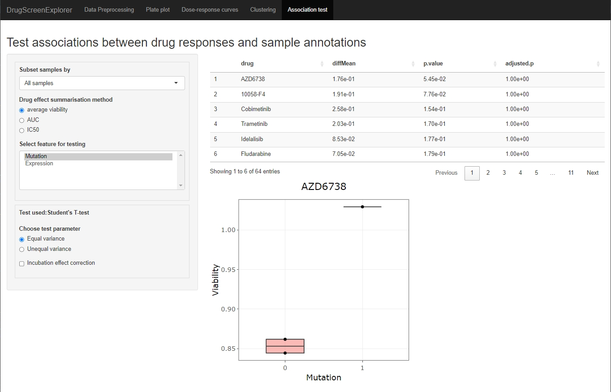

```

For continuous sample annotation variables, correlation with drug responses will
be calculated. Spearman correlation will be used as a non-parametric alternative 
to Pearson correlation. The relationship can be visualized using scatter plots 
with fitted trend lines to illustrate the association between variables and drug 
response.

If *Edge Effects Adjustment* is performed in the *Data Preprocessing* panel, 
an option for *Incubation Effect Correction* will become available. When 
selected, it enables the use of edge-effect corrected drug responses in the 
association test. 


```{r, out.width = "900px", echo = FALSE}

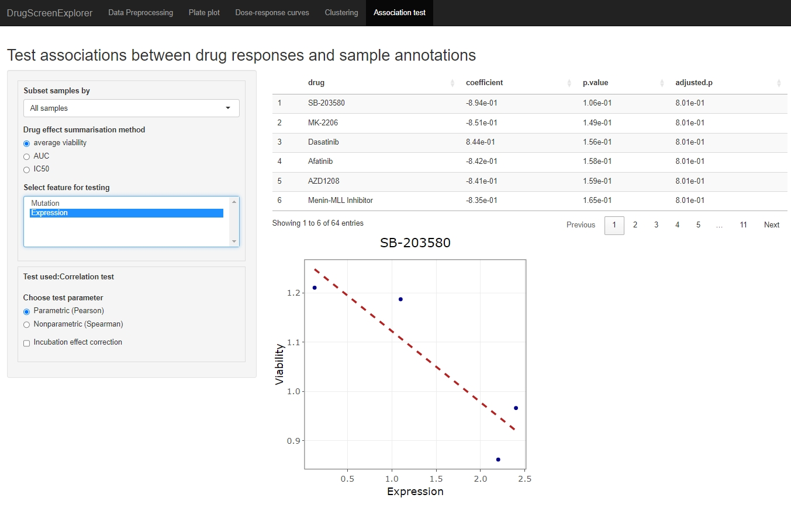

```

# Using Shiny Application to explore the two-drug combination effects

Once a *drug2* column was detected in the well annotation profile, the R Shiny 
application automatically switches to the mode designed for exploring two-drug 
combination effects. 

In the current version, there are four panels available: Data Preprocessing,
Plate Plot, Overview of Two-drug Combination, and Drug combination effects. 

The *Data preprocessing procedure* is the same as when handling a single drug, 
except for specifying the negative control wells and positive wells. In two-drug 
combinations, the drug names are linked by an underscore.

*Plate plot* panel is also similar to that in the single-drug scenario. By 
clicking a well in the heatmap, the trend of drug effects across concentrations 
will be displayed in a two-dimensional plot 


```{r, out.width = "900px", echo = FALSE}

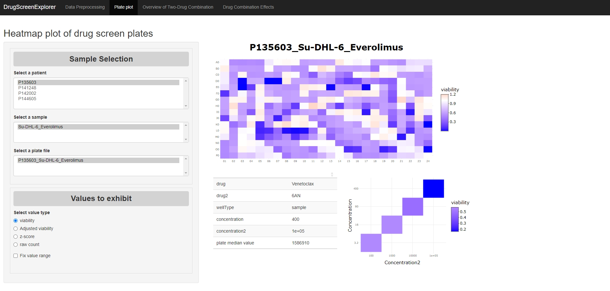

```

The *Overview of Two-Drug Combination* panel summarizes and visualizes the effects 
of two-drug combinations estimated using either the *bliss* or *bayesynergy* methods.

When the *bliss* method is applied, two types of combination indices are available:

- **CI**: Combination Index  
- **logCI**: Log-transformed Combination Index

The **CI** is defined as: $CI = viabObs - viabExp$, where *viabObs* and *viabExp*
are Observed viability and Expected viability. 

- If \( CI > 0 \): **Antagonism**
- If \( CI = 0 \): **Additive / Independent**
- If \( CI < 0 \): **Synergy**
 

Likelywise, **logCI** is defined as $logCI = log10(viabObs / viabExp)$.

- If \( logCI > 0 \): **Antagonism** (Observed viability > Expected)
- If \( logCI = 0 \): **Additive / Independent**
- If \( logCI < 0 \): **Synergy** (Observed viability < Expected)


Of note, the *bayesynergy* package need to be installed manually from 
*https://github.com/ocbe-uio/bayesynergy* if *bayesynergy* methods is selected 
to assess the drug combination effects. 


```{r, out.width = "900px", echo = FALSE}

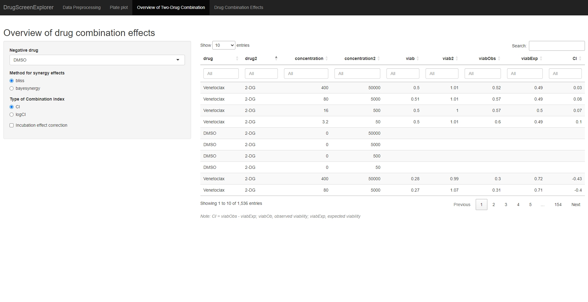

```

The *Drug Combination Effects* panel enables the visualization of combination effects. 
For the *Bliss* method, three types of plots are available: the Dose–Response Curve, 
which compares observed versus expected viability across concentrations; the 
Scatter Plot, which displays the relationship between observed and expected 
viability at different concentrations; and the Box Plot, which illustrates the 
distribution of the combination index across different samples.

```{r, out.width = "900px", echo = FALSE}

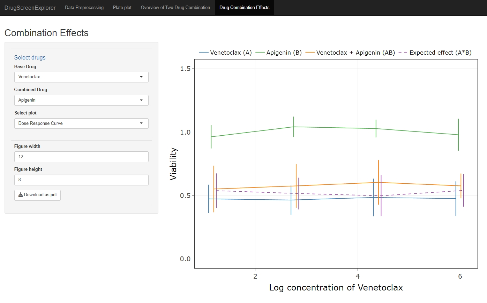

```

For the *bayesynergy* method, the R Shiny application provides two main 
visualization plots: "Synergy Against Antagonism" and "Pairwise Drug Interaction", 
which can display results averaged across all samples or for individual samples. 
Additionally, the "Synergy Per Experiment ID" plot summarizes synergy effects by sample.

The "Synergy Against Antagonism" plot displays synergy and antagonism effects 
of different drug combinations in a scatter plot. Meanwhile, the "Pairwise Drug 
Interaction" plot provides an overview of synergy effects for all drug pairs.

All generated plots can be downloaded in PDF format to a local repository.


```{r, out.width = "900px", echo = FALSE}

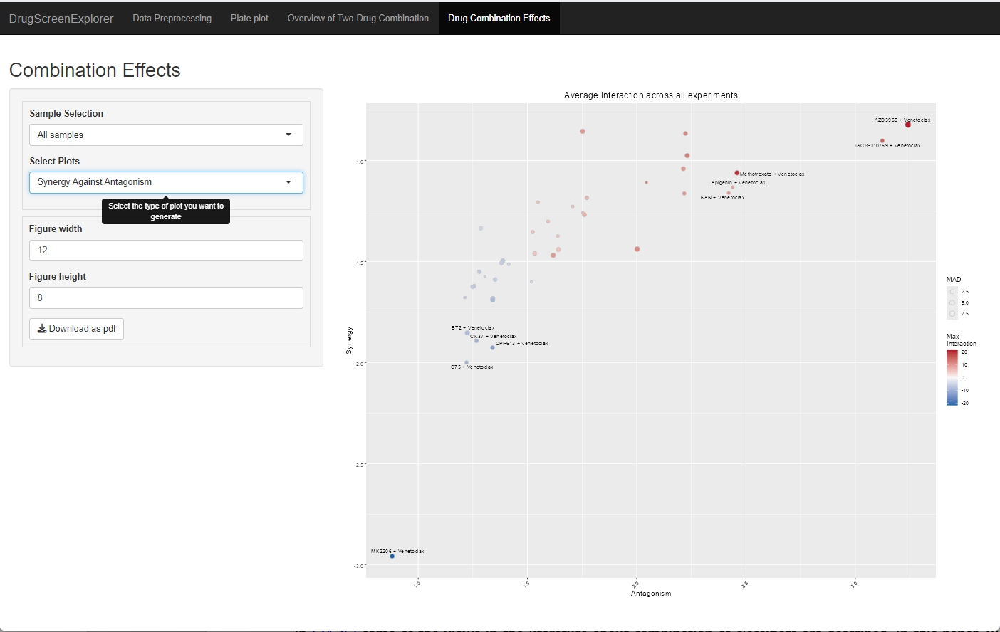

```


# SessionInfo
```{r}
sessionInfo()
```


